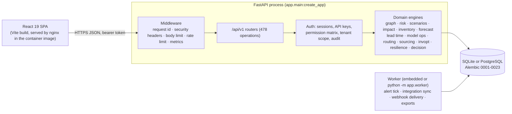

# Architecture

ATLAS is a modular monolith: one FastAPI process serving a versioned JSON API, an optional worker process for
background jobs, one relational database (SQLite or PostgreSQL), and a React single-page app.

## Layers and boundaries

| Layer | Location | Responsibility |
|---|---|---|
| Presentation | `frontend/src/pages`, `components` | Pages per module; every API call goes through `lib/api.ts` or `lib/registryApi.ts`, which share one token store (`lib/token.ts`). |
| API | `backend/app/api/v1/*.py` | Request validation (Pydantic, `extra="forbid"`), permission dependencies, write gate, audit records, response shaping. No business rules. |
| Domain | `backend/app/<area>/` | Engines and services: pure calculation modules (e.g. `invopt/safety.py`, `sourcing/solver.py`) separated from run orchestration (`runs.py`) and persistence (`data.py`). |
| Persistence | `backend/app/models`, `alembic/versions` | SQLAlchemy 2 models with check/unique constraints; schema changes only through migrations (the app never calls `create_all`). |
| Cross-cutting | `backend/app/core` | Settings (only place that reads the environment), errors, logging, rate limiting, cache, permissions, OpenAPI security. |

## Request path

1. Middleware assigns a request id, enforces body size and per-credential rate limits, adds security headers.
2. The auth dependency resolves the bearer token (user session, API key or static service token) to an `Actor`
   and records the actor on the request. The request's database session reads the organisation from it, and every
   query on an organisation-owned model is filtered to that organisation (`app/db/tenancy.py`).
3. A permission dependency (`require_permission`) checks the role matrix in `app/core/permissions.py`.
4. The router calls a domain service inside a transaction; failures map to a uniform error body
   `{"error": {"code", "message", "request_id"}}` with no stack traces.
5. Writes are audited in a hash-chained log (`/registry/audit/verify` re-checks the chain).

## Long-running work

Analyses (risk runs, simulations, impact, stockout, forecasts, optimisation) are recorded as *runs* with a status,
inputs hash, methodology version, limits and a time budget. Each area caps concurrently active runs. Results are
persisted with provenance so they can be compared and cited as decision evidence.

## Key design decisions

| Decision | Why | Cost |
|---|---|---|
| Modular monolith | One schema and transactional consistency across modules; packages have clear boundaries and could be split out later. | Scales vertically; a slow analysis shares the process (run limits and time budgets contain it). |
| SQLite by default, PostgreSQL supported | No setup for local use and tests on a real database file; PostgreSQL for shared deployments. | SQLite has one writer, so writers queue (`BEGIN IMMEDIATE`). |
| Pure-Python models (no numpy/scikit-learn) | Small dependency surface, inspectable maths, deterministic tests. | Slower on large data. |
| Rule-based supplier risk | There are no labelled outcomes to train or validate a classifier on. | An indicator, not a probability. |
| Exact optimisation on bounded problems | Results can be checked against brute force and infeasibility can be explained. | Large instances return `BOUND_EXCEEDED` instead of a heuristic answer. |
| Runs as records | Reproducible, citable results: inputs hash, method version, limits, status. | More tables than computing on request. |
| Unknown is never zero | Missing inventory or evidence must not look safe. | More states in the UI. |
| Server-side sessions, bearer header | Immediate revocation; no ambient credential, so no CSRF surface. | A lookup per request; the token sits in sessionStorage (strict CSP, no `innerHTML`/`eval`). |
| Query-layer tenant filter | A query cannot forget the organisation filter; the session adds it. | Raw SQL would bypass it, so the application uses none. |

## Known architectural limits

- **SQLite allows one writer at a time.** Write requests and background runs open `BEGIN IMMEDIATE` transactions so
  they queue instead of failing (`app/db/session.py`). PostgreSQL 16 passes the migrations and test suite but has not
  run in a deployment.
- **Analyses run in the API process,** bounded by limits and time budgets, not in a separate job queue.
- **Organisations share one database,** with every table scoped at the query layer
  ([`security/TENANT_ISOLATION.md`](security/TENANT_ISOLATION.md)).
- See [`limitations.md`](limitations.md).
